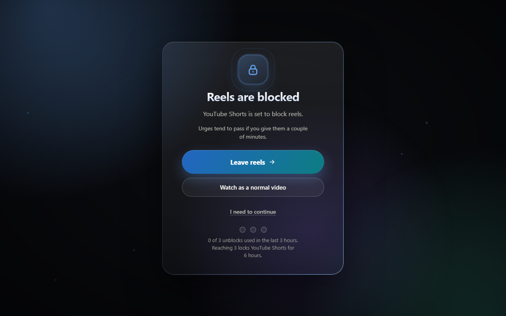
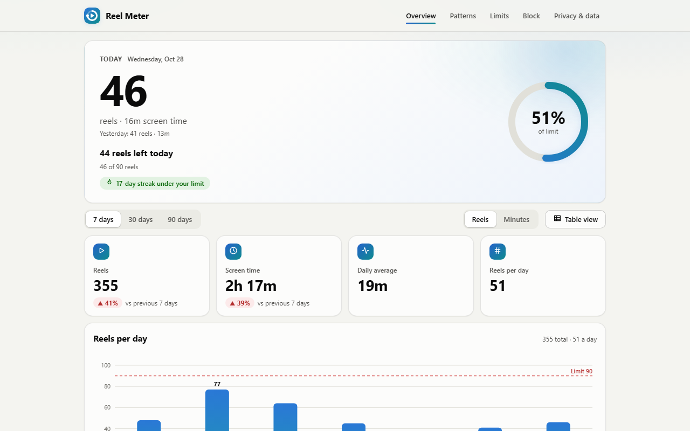
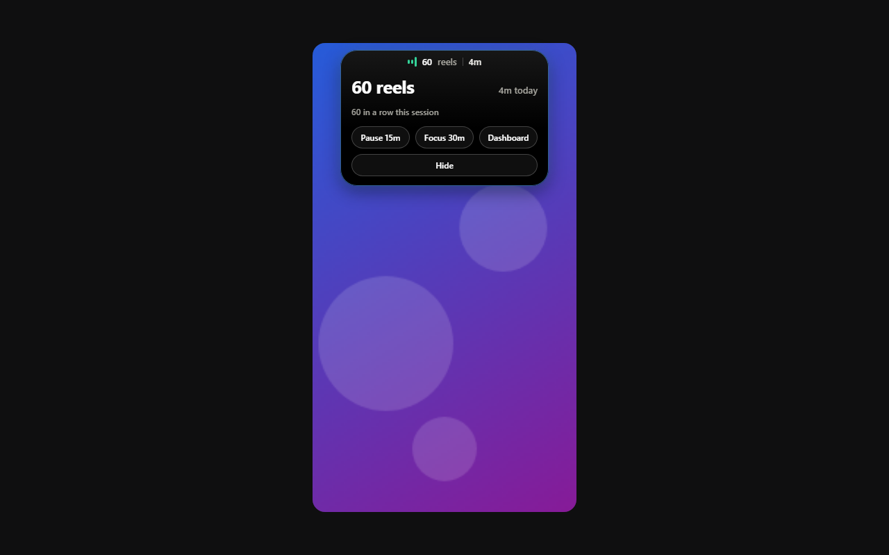
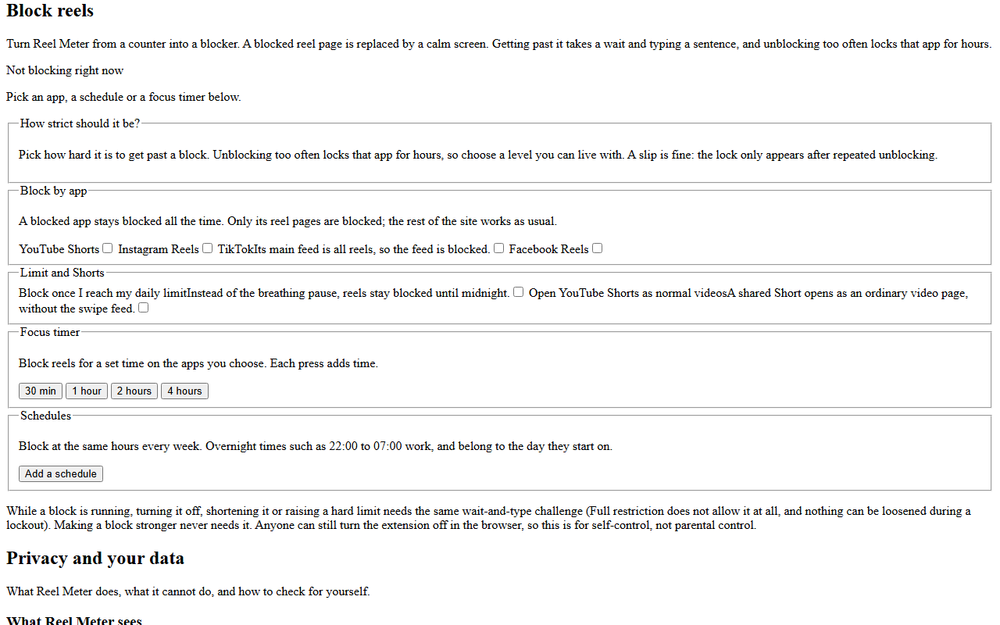
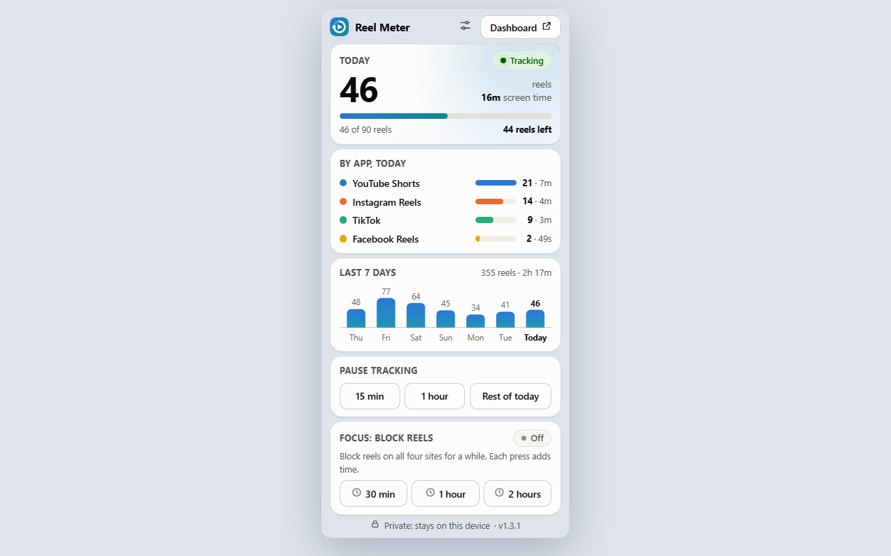

<div align="center">


# Reel Meter

**Count your Shorts, Reels and TikToks. Block them when you want your time back.**
Private by design: everything stays on your device.

[](https://github.com/Pranto-404/Reel-meter/actions/workflows/ci.yml)
[](https://github.com/Pranto-404/Reel-meter/releases/latest)
[](LICENSE)


[Install](#install) · [Features](#features) · [Blocking levels](#blocking-levels) · [Privacy](#privacy-you-can-verify) · [Develop](#develop) · [Roadmap](#roadmap)

</div>

<p align="center">
  
</p>

## Why

Short videos are built to be hard to stop. Reel Meter gives you honest numbers first, then gentle friction: a live counter, daily limits, and an optional blocker that makes you pause, wait and type a sentence before you continue. It works on **YouTube Shorts, Instagram Reels, TikTok and Facebook Reels** in Chrome, Edge, Brave and Firefox.

It never reads your screen, video titles, accounts or comments, and it has no way to send data anywhere.

## Install

**From a release (recommended)**

1. Download the zip for your browser from the [latest release](https://github.com/Pranto-404/Reel-meter/releases/latest): `…-chrome-edge.zip` for Chrome, Edge, Brave and Opera, or `…-firefox.zip` for Firefox.
2. Unzip it somewhere permanent.
3. Chrome / Edge / Brave: open `chrome://extensions` (Edge: `edge://extensions`), turn on **Developer mode**, click **Load unpacked** and pick the unzipped folder.
   Firefox: open `about:debugging#/runtime/this-firefox`, click **Load Temporary Add-on** and pick `manifest.json`.
4. Refresh any YouTube, Instagram, TikTok or Facebook tab that was already open.

**From source:** clone this repository and load the folder the same way. There is no build step.

## Features

| | |
|---|---|
| **Live counter** | A small "island" at the top of the reel: reels and minutes today. Tap it for details, pause, resume or open the dashboard. |
| **Dashboard** | 7/30/90 day charts, per-app split, a weekday-by-hour pattern map, plain-language observations, weekly comparison. |
| **Limits and nudges** | Daily limit in reels and/or minutes, a heads-up at 80%, a reminder every N reels, a breathing pause when you hit the limit, optional greyscale. |
| **Reel blocker** | Block per app, focus timers, schedules, a hard daily limit, and Shorts opened as normal videos. |
| **Your data** | Export counts as JSON or CSV. Delete them in one click. |

<p align="center">
  
  
</p>
<p align="center">
  
  
</p>

## Blocking levels

Blocking is **per app**: unblocking Facebook never unblocks YouTube. A blocked reel page is replaced by a block screen. Getting past it takes a wait and typing a sentence, and opens a **5 minute break** for that app only; the counter then offers *Block now*.

| Level | Wait | Unblocks before a lockout | Lockout | Notes |
|---|---|---|---|---|
| Less restriction | 10 s | 5 in 60 min | 1 hour | Gentle nudge |
| **Restricted** (default) | 30 s | 3 in 3 hours | 6 hours | Counted from when the third break ends |
| Full restriction | 60 s | 2 in 24 hours | 12 hours | Timed blocks (focus, schedule, limit) cannot be unblocked; loosening is never allowed |

Loosening a running block needs the same challenge, checked by the background worker with its own clock (not allowed on Full restriction or during a lockout). With a hard daily limit on, pausing and switching an app off do not stop the count.

## How counting works

| Thing | Rule |
|---|---|
| A reel counts | after it has played for 2 seconds (adjustable 1 to 10) |
| Time counts | only while a video is on screen, playing, and the tab is visible |
| Idle | timing stops after 2 minutes without touching the page (adjustable) |
| Looping | a reel that loops is counted once |
| YouTube, Instagram, Facebook | the reel is told apart by the page address changing |
| TikTok For You feed | the address never changes, so the video on screen is used instead |

Stored per day: reels and seconds in total and per app, plus seconds per hour of the day. No video ids, titles, URLs or timestamps of single reels. Days older than 400 are removed.

## Privacy you can verify

- Permissions are only `storage` and `alarms`. No `tabs`, `history`, `webRequest` or `downloads`.
- It runs only on the four sites listed in `manifest.json`.
- Extension pages carry a strict security policy (`default-src 'none'`, scripts only from the extension itself, `connect-src 'none'`, no frames, no forms). `npm run harness` loads the dashboard and the popup under that exact policy and fails on any violation.
- `npm test` fails if the permissions grow, if any source file uses `fetch`, `XMLHttpRequest`, `WebSocket`, screen capture or similar, or if the message the page script sends ever carries more than platform, seconds and reels.
- Full policy: [store/PRIVACY.md](store/PRIVACY.md).

## Develop

No dependencies and no build step: plain JavaScript loaded straight from the folder.

```bash
npm test          # unit tests and static privacy checks (about 2 s)
npm run harness   # the real content script + worker against a fake page in headless Chrome (about 90 s)
npm run build     # store-ready zips in dist/
npm run shots     # regenerate the store screenshots
```

```
manifest.json     Manifest V3 manifest
src/core.js       all pure logic: URL rules, tracker, stats, limits, blocking rules (no browser APIs)
src/content.js    runs on the four sites: counter island, toasts, pause overlay, block screen
src/background.js service worker: saves totals, badge, validates every unblock
src/ui/           popup, dashboard, block settings panel
test/             unit tests and static privacy checks (node:test)
dev/              fake-chrome harnesses and preview tools
store/            listing text, privacy policy, screenshots, promo image
docs/             architecture, publishing guide, design notes
```

More: [CONTRIBUTING.md](CONTRIBUTING.md) · [docs/ARCHITECTURE.md](docs/ARCHITECTURE.md) · [docs/PUBLISHING.md](docs/PUBLISHING.md) · [CHANGELOG.md](CHANGELOG.md)

## Troubleshooting

| Symptom | Fix |
|---|---|
| No counter on a reel page | Refresh the tab (F5). Check the extension is on and the site is one of the four supported. |
| Counter is there but you cannot see it | It sits at the top centre of the reel. Change **Counter position** in the dashboard, or drag it. |
| Count stays at 0 | A reel counts after 2 seconds of playing, only while the video plays and the tab is visible. Check the app is ticked under "Apps to track". |
| "I need to continue" shows "Something went wrong (…)" | Remove the extension and **Load unpacked** again. Browsers can keep a stuck copy of an unpacked extension after many reloads. |
| Still wrong | Right-click the page, Inspect, Console, and look for red lines mentioning Reel Meter. The extension's card also has an **Errors** button. |

## Known limits

- Sites change. If a site changes how its reel pages are addressed, counting for it stops until `classify()` in `src/core.js` is updated (one small function with tests).
- Not covered: reels inside iframes, Instagram `/p/` posts, Facebook `/watch`, TikTok `/explore`.
- No cross-device totals: each browser keeps its own numbers.
- Turning the extension off or using DevTools bypasses any block. It is a habit tool, not parental control.

## Roadmap

- [x] Counter, dashboard, limits and nudges
- [x] Reel blocker with per-app breaks, three restriction levels and lockouts
- [ ] Store listings (Chrome Web Store, Edge Add-ons, Firefox Add-ons)
- [ ] Android app (screen time per app with the same privacy rules)

## Contributing, security and license

[CONTRIBUTING.md](CONTRIBUTING.md) · report security problems privately via [SECURITY.md](SECURITY.md) · released under the [MIT License](LICENSE).

Reel Meter is not affiliated with, endorsed by, or sponsored by YouTube, Google, Instagram, Facebook, Meta or TikTok.
