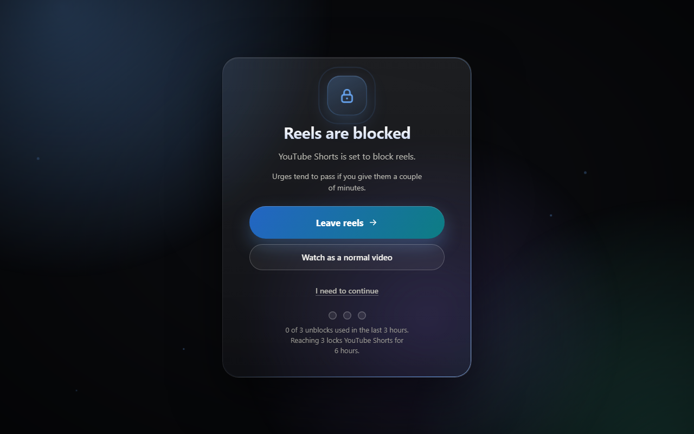

<div align="center">


# Reelity

**Know your scroll. Stay in control.**
Count your Shorts, Reels and TikToks, and block them when you want your time back. Everything stays on your device.

[](https://github.com/Pranto-404/Reel-meter/actions/workflows/ci.yml)
[](https://github.com/Pranto-404/Reel-meter/releases/latest)
[](LICENSE)


</div>

<p align="center">
  
</p>

## Products

| | Status | Where |
|---|---|---|
| **Browser extension** for Chrome, Edge, Brave and Firefox | Released | [`extension/`](extension/README.md) · [download](https://github.com/Pranto-404/Reel-meter/releases/latest) · [changelog](extension/CHANGELOG.md) |
| **Android app** | In development (M0 skeleton) | [`android/`](android/README.md) · [roadmap](docs/android/ROADMAP.md) · [architecture](docs/android/ARCHITECTURE.md) |

Both follow the same privacy promise: no account, no analytics, no network access, nothing about what you watch is ever stored. Both will run the same counting and blocking rules, checked by shared tests.

## Repository layout

```
extension/   the browser extension (Manifest V3, plain JavaScript, no dependencies)
android/     the Android app (Kotlin and Jetpack Compose, in development)
shared/      test cases both products must pass (coming)
docs/        extension/ and android/ design notes, HANDOFF.md (project history)
.github/     CI, releases, issue and PR templates
```

## Contributing, security and license

[CONTRIBUTING.md](CONTRIBUTING.md) · report security problems privately via [SECURITY.md](SECURITY.md) · released under the [MIT License](LICENSE).

Reelity is not affiliated with, endorsed by, or sponsored by YouTube, Google, Instagram, Facebook, Meta or TikTok.
